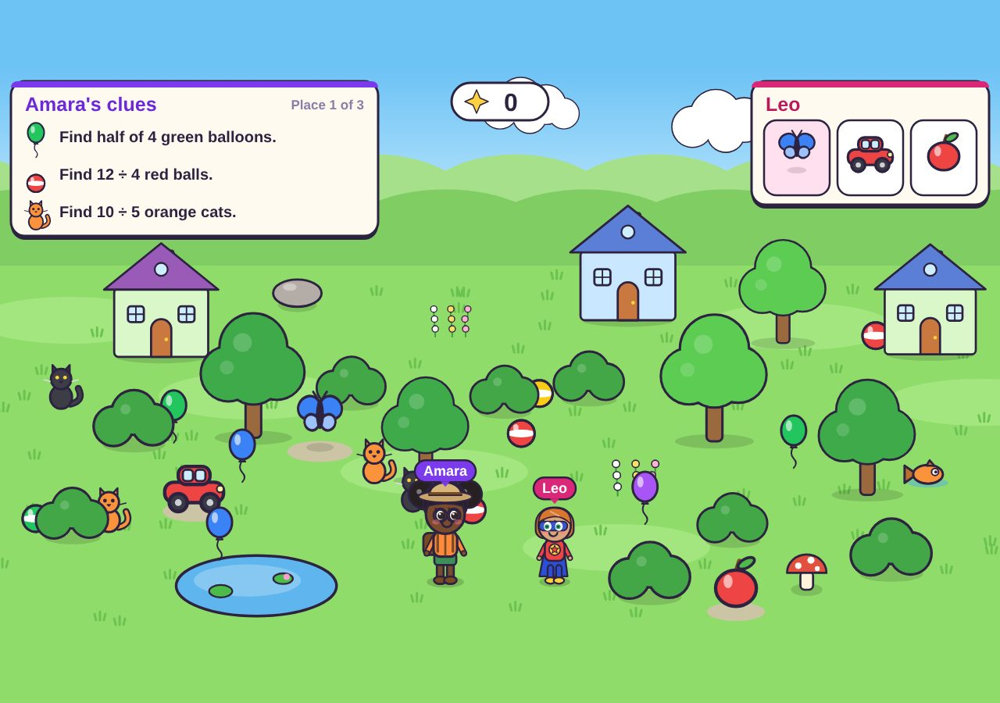
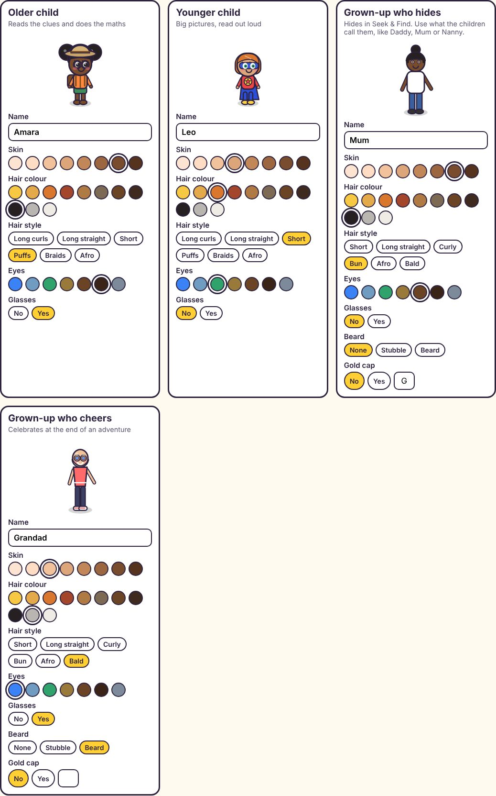

# Kids Games

**Free, quietly educational games for children that any family can make look like their own.**

I built these for my two daughters, one aged three and one aged eight. Finding games they could enjoy at the same time was surprisingly hard when one is learning her colours and the other is racing through her times tables, so I made three with Claude and slipped some learning into each one. Then I made the characters changeable, because every child deserves to see themselves in the game.

**Play it live:** [Kids Games](https://garystow.co.uk/kids-games/)
**How and why I built it:** [Kids Games on my Work page](https://garystow.co.uk/work/#play)

## Play it in 3 steps (no coding)

1. At the top of this page, click the green **Code** button, then **Download ZIP**.
2. Open your **Downloads** folder, right-click the ZIP, choose **Extract All**, then **Extract**.
3. Open the new folder and double-click **index.html**. The games open in your web browser.

Use **Microsoft Edge** or **Google Chrome** so your family settings carry across all three games. Or skip the download altogether and play [online](https://garystow.co.uk/kids-games/), where the **Add to this computer** button gives the games their own icon and lets them work without the internet.

## The games

| Game | Who for | What they're quietly learning |
|---|---|---|
| **Seek & Find** | Two players on one keyboard, or either on their own | The older child reads clues and solves times tables, division and halves to work out what to find. The younger child hears big pictures read aloud and counts them. Then everyone finds the grown-up who's hiding. |
| **Times Table Pegs** | Older child | Every times table from 1 × 1 to 12 × 12 plus division, in a glowing peg game. Pick all of them or just the ones being practised. Wrong answers come back a little later. |
| **Paint Splash** | Younger child, older one can join | Colours and shapes. Run through paint buckets to paint the floor, then stand in the bubble bath for a moment to wipe it clean. |

No adverts, no accounts, no timers and nobody loses. Works with a keyboard, a mouse, a tablet or two gamepads.

## Make it yours

- On the Kids Games page, scroll to **Make it yours**. For each child and two grown-ups, pick a name, skin tone, hair colour, hair style, eyes and glasses. Grown-ups can have a beard or a gold cap too.
- Under **Dress up**, every child can wear every outfit, from Superhero to Princess to Football kit.
- Everything you choose stays in the browser on that device. Nothing is sent anywhere.

Want to change more than that? You don't need to be a coder. Open the file below in an AI assistant such as Claude, Copilot or ChatGPT and ask in plain English, for example: *"In this file, add a new outfit called Astronaut with a white suit and a round helmet, in the same style as the others."* Save the file and refresh the page.

## Your own copy on the web

1. Sign in to GitHub (it's free), click **Use this template** at the top of this page, then **Create a new repository**.
2. Name it `kids-games` and click **Create repository**.
3. Click **Settings**, then **Pages** on the left. Under **Branch**, choose **main**, then **Save**.
4. After a minute or two it's live at `https://YOUR-GITHUB-NAME.github.io/kids-games/`, and the **Add to this computer** button works there too.

## Files

| File | What it does |
|---|---|
| `index.html` | The Kids Games page: the three games, Dress up, Make it yours and setup steps |
| `shared.js` | Everything the games share: drawing, sound, the voice, the family characters, outfits, skin tones and hair |
| `seek/index.html` | Seek & Find: the three places to explore, the clues and the hiding grown-up |
| `pegs/index.html` | Times Table Pegs: the questions, the five levels and the peg layouts |
| `paint/index.html` | Paint Splash: the paint colours, shapes and the bubble bath |
| `sw.js`, `manifest.webmanifest` | Let the browser keep an offline copy and give the games their own icon |

Everything is drawn in code, so there are no image files to replace.

## Credit

Built by [Gary Stow](https://garystow.co.uk/) with [Claude](https://claude.ai), for Bell and La La. MIT licence: use it however you like. If you share your version, a link back to [garystow.co.uk/kids-games](https://garystow.co.uk/kids-games/) is appreciated, and I'd love to see it on [LinkedIn](https://linkedin.com/in/garystow).
